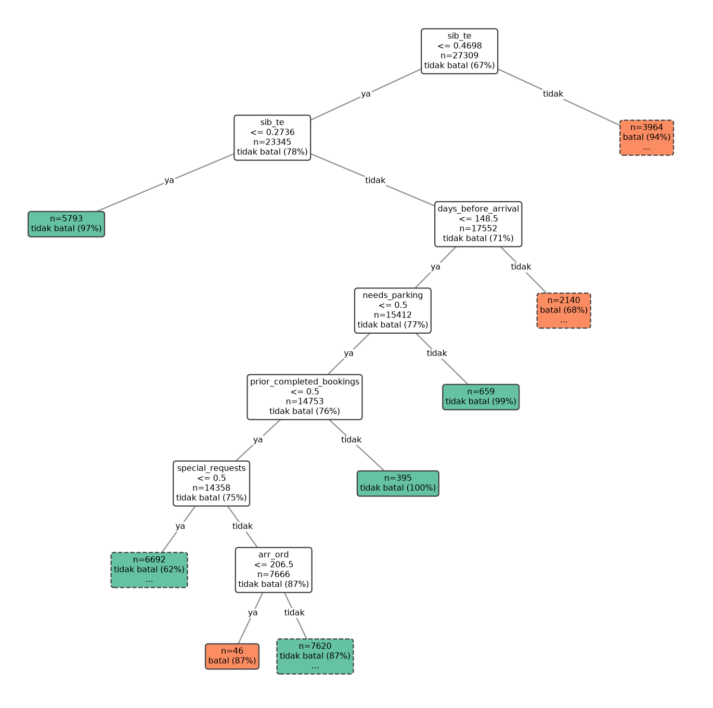

# IF3170_G04_TreeIsAllYouNeed

Prediksi pembatalan pemesanan penginapan dengan KNN, DTL, Logistic Regression, SVM, dan Naive Bayes yang dibuat dari nol.

Repositori ini adalah Tugas Besar 2 IF3170 Inteligensi Artifisial 2026/2027 Kelompok 04. Kelima
algoritma diimplementasikan *from scratch* dengan NumPy di [`src/algoritma/`](src/algoritma),
dibandingkan dengan padanannya di scikit-learn, lalu dipakai untuk submisi
[kompetisi Kaggle](https://www.kaggle.com/t/f1501c0f1c234e5eabe5b479e7ced777).

[Hasil Kaggle](#hasil-kaggle) · [Instalasi](#instalasi) · [Menjalankan](#menjalankan) ·
[Struktur](#struktur-repositori) · [Pembagian tugas](#pembagian-tugas)



## Hasil Kaggle

Setiap submisi berasal dari satu model *from scratch* tanpa *ensemble*.

| Model | Notebook | Berkas submisi | CV Macro F1 | *Public score* |
| --- | --- | --- | --- | --- |
| SVM kernel Laplacian | [`svm_notebook.ipynb`](src/kaggle/svm_notebook.ipynb) | [`output/svm/submission.csv`](output/svm/submission.csv) | 0,8703 | 0,87464 |
| DTL C4.5 | [`dtl_notebook.ipynb`](src/kaggle/dtl_notebook.ipynb) | [`output/dtl/submission.csv`](output/dtl/submission.csv) | 0,8672 | 0,87393 |

CV adalah rata-rata tujuh *seed* untuk SVM dan sepuluh *seed* untuk DTL. Analisis lengkap ada di
laporan ([`docs/laporan/`](docs/laporan)).

## Isi implementasi

| Algoritma | Kode | Yang diimplementasikan |
| --- | --- | --- |
| KNN | [`src/algoritma/knn/`](src/algoritma/knn) | Klasifikasi tetangga terdekat dengan `predict_proba` |
| DTL | [`src/algoritma/dtl/`](src/algoritma/dtl) | C4.5: atribut numerik dan kategorikal, *missing value*, *pruning*, gambar pohon *top-N* |
| Logistic Regression | [`src/algoritma/lr/`](src/algoritma/lr) | Regularisasi L1, L2, dan Elastic Net; video kontur *log-loss* |
| SVM | [`src/algoritma/svm/`](src/algoritma/svm) | Kernel *linear*, *polynomial*, Gaussian (RBF), dan Laplacian |
| Naive Bayes | [`src/algoritma/nb/`](src/algoritma/nb) | Naive Bayes campuran (Gaussian dan kategorikal) serta Tree-Augmented Naive Bayes |

Setiap model dapat disimpan dan dimuat ulang. DTL, Logistic Regression, SVM, dan Naive Bayes
menyediakan metode `save` dan `load`; model KNN disimpan dengan `pickle` oleh
[`knn_submission.py`](src/kaggle/knn_submission.py).

## Instalasi

Prasyarat: Python 3.12.

1. Clone repositori dan masuk ke foldernya.

   ```bash
   git clone https://github.com/MAJIIDMN/IF3170_G04_TreeIsAllYouNeed.git
   cd IF3170_G04_TreeIsAllYouNeed
   ```

2. Buat *virtual environment* dan pasang dependensi yang sudah dipatok versinya.

   ```bash
   python3 -m venv .venv
   source .venv/bin/activate
   pip install -r requirements.txt
   ```

3. Jalankan *unit test* untuk memastikan instalasi berhasil.

   ```bash
   bash test/test.sh
   ```

   Keluaran yang diharapkan diakhiri dengan:

   ```text
   Ran 57 tests in 6.941s

   OK
   ```

Dataset Kaggle sudah tersedia di [`src/kaggle/dataset/`](src/kaggle/dataset) (`train.csv`,
`test.csv`, `sample_submission.csv`), jadi tidak perlu diunduh terpisah.

## Menjalankan

### Notebook per algoritma

Buka Jupyter dari akar repositori, lalu jalankan notebook dari atas ke bawah. Setiap notebook
melatih model dari data mentah, menyimpan model ke `output/`, memuatnya kembali, dan menulis berkas
submisi.

```bash
jupyter lab
```

| Notebook | Isi | Keluaran |
| --- | --- | --- |
| [`src/kaggle/eda.ipynb`](src/kaggle/eda.ipynb) | Eksplorasi data | `output/eda/` |
| [`src/kaggle/knn_notebook.ipynb`](src/kaggle/knn_notebook.ipynb) | KNN | `output/knn/` |
| [`src/kaggle/dtl_notebook.ipynb`](src/kaggle/dtl_notebook.ipynb) | DTL C4.5, perbandingan dengan `DecisionTreeClassifier` (ID3, C4.5, CART) | `output/dtl/` |
| [`src/algoritma/lr/lr.ipynb`](src/algoritma/lr/lr.ipynb) | Logistic Regression | `output/lr/` |
| [`src/kaggle/svm_notebook.ipynb`](src/kaggle/svm_notebook.ipynb) | SVM | `output/svm/` |
| [`src/kaggle/nb_notebook.ipynb`](src/kaggle/nb_notebook.ipynb) | Naive Bayes dan TAN | |

### Skrip submisi

KNN dan Logistic Regression juga dapat dijalankan langsung dari terminal untuk menghasilkan
submisi.

```bash
python3 src/kaggle/knn_submission.py
```

```bash
python3 src/kaggle/lr_submission.py
```

## Struktur repositori

```text
src/
  algoritma/   implementasi from scratch: knn, dtl, lr, svm, nb
  kaggle/      notebook per algoritma, skrip submisi, dan dataset
docs/laporan/  sumber LaTeX laporan
output/        model tersimpan, submisi, tabel, dan gambar hasil run
test/          unit test
```

## Pembagian tugas

| NIM | Nama | Tugas |
| --- | --- | --- |
| 13524006 | Gabriella Botimada Lubis | KNN |
| 13524008 | Agatha Tatianingseto | Naive Bayes dan TAN |
| 13524028 | Muhammad Nur Majiid | DTL, integrasi repositori |
| 13524068 | Athilla Zaidan Zidna Fann | SVM, eksplorasi data |
| 13524098 | Reva Natania Sitohang | Logistic Regression |
